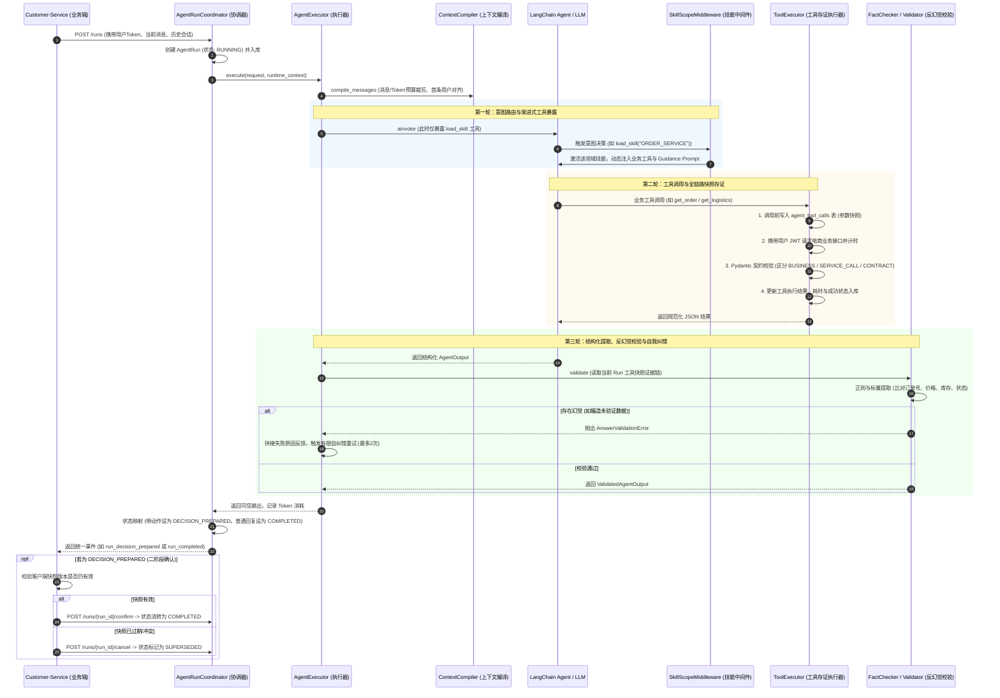
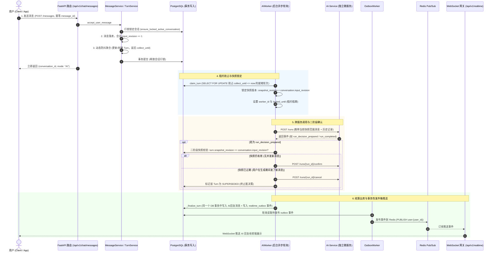

# 电商智能客服系统技术实现文档

> 本文整理 AI-Service 与 Customer-Service 的全流程实现、核心模块、项目亮点与关键代码。

## 目录


* [总体架构](#一总体架构)

* [AI-Service 实现全流程](#二ai-service-实现全流程)

* [Customer-Service 实现全流程](#三customer-service-实现全流程)

* [端到端协作流程](#四端到端协作流程)

* [项目整体亮点总结](#五项目整体亮点总结)

* [关键设计原则](#六关键设计原则)

* [项目目录结构](#七项目目录结构)

* [虚拟机搭建与使用](#八虚拟机搭建与使用)

* [项目启动与运行](#九项目启动与运行)

* [ecommerce-service 详解（作用与意义）](#十ecommerce-service-详解作用与意义)


***

## 一、总体架构

系统由两个核心服务协同组成：


| 服务               | 定位        | 核心职责                                                        |
| ---------------- | --------- | ----------------------------------------------------------- |
| AI-Service       | 智能客服决策大脑  | 单轮推理、动态技能路由、工具调用、事实校验、反幻觉、自纠错、二阶段决策                         |
| Customer-Service | 业务中枢与调度网关 | 会话生命周期、消息防抖聚合、租约调度、AI Worker、二阶段确认、Outbox 推送、WebSocket 实时通信 |

整体链路：


1. 用户发送消息到 Customer-Service。

2. Customer-Service 完成幂等落库、会话行锁、防抖聚合，生成或更新 Turn，并递增 `input_revision`。

3. 后台 AI Worker 通过租约抢占就绪 Turn，锁定 `snapshot_revision`。

4. Worker 调用 AI-Service `/runs`。

5. AI-Service 执行上下文编译、技能路由、工具调用存证、反幻觉校验与自纠错。

6. 若 AI 返回 `DECISION_PREPARED`，Customer-Service 校验快照版本，决定 `confirm` 或 `cancel`。

7. Customer-Service 在同一个数据库事务中写入 AI 回复与 Outbox 事件。

8. OutboxWorker 发布到 Redis，WebSocket 网关推送给前端。


***

## 二、AI-Service 实现全流程

### 2.1 服务定位

AI-Service 是整个电商系统的智能客服决策大脑。它不是简单的 Prompt 问答包装，而是一套企业级、带安全护栏、支持动态技能路由、具备全链路审计存证与反幻觉自纠错机制的 Agent 运行时框架。

核心能力包括：


* 动态技能路由与渐进式工具暴露

* 上下文编译与 Token 预算控制

* 工具调用全链路快照存证

* 反幻觉事实校验

* 有限自纠错重试

* 页面动作白名单

* 二阶段确认机制

* 全链路审计与状态机管理

### 2.2 全流程时序图




### 2.3 全流程核心阶段拆解

#### 1. 服务初始化与依赖装配


* 依赖入口：`app.py`。

* 在应用生命周期 `lifespan` 中，通过 `create_support_agent` 构建唯一的 Agent 实例并挂载到 `app.state.agent`。

* 包含微服务鉴权中间件 `require_internal_service`，校验 `X-Internal-Service-Token`。

#### 2. 请求创建与状态机初始化


* 路由入口：`routers/run.py`。

* `AgentRunCoordinator.start_run` 接收请求，创建 `AgentRun` 实体，状态为 `RUNNING`。

* 保存当前模型配置、Prompt 版本及原始上下文快照入库。

* 组装 `AgentRuntimeContext`，内含 `run_id` 与用户的 `access_token`，用于后续工具代客鉴权。

#### 3. 上下文编译与预算控制

核心文件：`context.py`。


* 消息条数裁剪：截取最近 `history_message_limit` 条。

* 倒序字符预算控制：按 `history_character_budget` 倒序截断，避免超出上下文窗口。

* 历史清洗对齐：确保截断后的第一条消息必须是用户角色的提问，剔除孤立的历史回复。

* 用户多消息合并：如果用户一轮连发多条消息，拼接聚合并提示模型以最新输入为主。

#### 4. 动态技能路由与渐进式工具暴露

核心文件：`middleware.py`、`dynamic_prompt.py`。


* 初始调用时，`SkillScopeMiddleware` 限制模型仅能看到 `load_skill` 一个工具，系统提示词仅提供技能索引。

* 模型分析意图后调用 `load_skill`，通过 LangGraph 的 `Command(update={"active_skill_code": ...})` 激活技能。

* 中间件拦截到激活状态，动态开放该领域工具，如商品、订单、物流。

* 同时拼接该领域专有的指导原则 Guidance。

#### 5. 工具执行与全链路快照存证

核心文件：`executor.py`。


* 工具执行前，在数据库 `AgentToolCall` 记录工具名称与调用入参。

* 携带用户的 JWT 请求电商微服务接口，计算耗时 `perf_counter`。

* 通过 Pydantic 校验结果，将异常结构化划分为：


  * 业务失败：`BUSINESS`

  * 服务调用失败：`SERVICE_CALL`

  * 契约失败：`CONTRACT`

* 将结果与状态写回数据库，形成不可篡改的工具调用审计链路。

#### 6. 反幻觉事实校验与自纠错

核心文件：`validator/output.py`、`rules/fact.py`。


* 模型输出结构化结果 `AgentOutput` 后，`AnswerValidator` 读取数据库中该 Run 的真实工具数据快照。

* `FactChecker` 提取模型回答中的业务编号、金额 / 库存、状态标签，校验其是否在工具快照证据池中。

* `PageActionValidator` 校验页面动作是否在白名单内，且关联的订单号必须在当前 Run 中被真实查验过。

* 若校验失败，`AgentExecutor` 将校验错误转化为反馈提示，驱动模型进行自纠错重试，最多 2 次。

#### 7. 二阶段提交 / 确认机制

核心文件：`coordinator.py`、`customer-service worker.py`。


* 若决策包含敏感页面动作，状态置为 `DECISION_PREPARED`。

* 业务微服务 Customer-Service 检查客户端当前快照版本。

* 若版本有效，发起 `/confirm`，状态变为 `COMPLETED`。

* 若版本已过期或用户发了新消息，发起 `/cancel`，状态置为 `SUPERSEDED`，保证并发一致性。

### 2.4 AI-Service 项目亮点


* 渐进式技能路由：初始只暴露 `load_skill`，按意图激活领域技能，再动态注入工具与 Guidance Prompt，降低 Token 消耗，提高工具调用准确率。

* 动态工具范围控制：`SkillScopeMiddleware` 按 `active_skill_code` 裁剪工具子集，并关闭并行工具调用，保证执行顺序可控。

* 全链路工具存证：`ToolExecutor` 在工具调用前后双向快照存证，记录入参、结果、耗时、成功状态，形成审计证据链。

* 契约化异常处理：通过 Pydantic 与结构化错误码区分业务失败、服务调用失败、契约失败。

* 反幻觉事实校验：`FactChecker` 从回复中提取订单号、金额、库存、状态等事实，与工具快照强一致比对，拦截 `UNSUPPORTED_FACT`。

* 有限自纠错：校验失败后追加系统反馈，保留思考轨迹，触发模型反思重试，最多 2 次，超出则安全降级。

* 页面动作白名单：模型只能输出枚举动作和资源 ID，服务端校验资源是否被真实查验，并由服务端模板组装安全路径。

* 二阶段确认：敏感决策进入 `DECISION_PREPARED`，由业务端确认快照版本后 `confirm` 或 `cancel`，避免过期决策执行。

* 防死循环保护：`ToolCallLimitMiddleware` 限制单轮最多 8 次工具调用，超出报错退出。

* 结构化输出：通过 `ToolStrategy(AgentOutput)` 强制 Pydantic 结构化输出，便于校验与状态映射。

### 2.5 AI-Service 重点代码清单与深度解析

#### 1. Agent 工厂与执行流水线装配

文件：`factory.py`

核心逻辑：采用装饰器与中间件管道模式，将动态 Prompt、技能范围过滤和工具调用频次限制集中编排。


```
def create_support_agent():
    """装配具备动态 Prompt、Skill 过滤与限流保护的智能客服 Agent"""
    return create_agent(
        model=ModelAdapter.create_model(),
        tools=TOOL_CATALOG.get_agent_tools(),
        response_format=ToolStrategy(AgentOutput),  # 强制 Pydantic 结构化输出
        state_schema=AgentExecutionState,
        context_schema=AgentRuntimeContext,
        middleware=[
            support_prompt,          # 1. 动态系统提示词中间件
            SkillScopeMiddleware(),  # 2. 渐进式 Skill 工具限制中间件
            ToolCallLimitMiddleware( # 3. 单轮最多 8 次工具调用硬上限，防止死循环
                run_limit=8,
                exit_behavior="error"
            )
        ],
        name="智能客服专家"
    )
```

#### 2. 渐进式 Skill 路由中间件

文件：`middleware.py`

核心逻辑：在每次模型调用前，依据当前 State 中是否激活 `active_skill_code`，动态裁剪暴露给模型的工具子集。


```
class SkillScopeMiddleware(AgentMiddleware[AgentExecutionState, AgentRuntimeContext, AgentOutput]):
    async def awrap_model_call(self, request, handler):
        # 1. 读取当前已经激活的领域技能
        active_skill_code = request.state.get("active_skill_code")
        # 2. 未激活技能时，仅开放 load_skill（极简路由）
        if active_skill_code is None:
            allowed_tool_names = {"load_skill"}
        else:
            # 3. 激活后，按需开放当前领域对应的工具集合
            skill = SKILL_CATALOG.get_skill(active_skill_code)
            allowed_tool_names = {"load_skill", *skill.tools}
        # 4. 覆盖请求中的 tools 列表，关闭并行工具调用保证顺序可控
        scoped_request = request.override(
            tools=[tool for tool in request.tools if tool.name in allowed_tool_names],
            model_settings={**request.model_settings, "parallel_tool_calls": False}
        )
        return await handler(scoped_request)
```

#### 3. 工具统一执行与审计快照存证

文件：`executor.py`

核心逻辑：所有只读工具执行的前后双向快照存证、高精度耗时统计、Pydantic 契约校验及异常安全归一化。


```
class ToolExecutor:
    async def execute(self, runtime_context, tool_call_id, tool_name, arguments, operation, output_schema) -> str:
        # 1. 调用前存证：将入参和工具名称写入 agent_tool_calls
        await self._create_tool_call(runtime_context, tool_call_id, tool_name, arguments)
        started_at = perf_counter()
        try:
            response_data = await operation()
        except Exception:
            # 2. 网络或外部微服务不可用时的安全保底
            tool_result = ToolResult[Any](
                success=False,
                code=ToolFailureCode.TOOL_CALL_FAILED,
                message="暂时无法取得可靠的业务数据",
                failure_type=ToolFailureType.SERVICE_CALL
            )
        else:
            # 3. 契约校验：区分业务失败(BUSINESS)还是契约不符(CONTRACT)
            tool_result = self._validate_result(response_data, output_schema)
        latency_ms = int((perf_counter() - started_at) * 1000)
        # 4. 调用后存证：记录结果快照、成功标志和延迟
        await self._save_tool_result(runtime_context.run_id, tool_call_id, tool_result, latency_ms)
        return json.dumps(tool_result.model_dump(mode="json"), ensure_ascii=False)
```

#### 4. 反幻觉事实校验器

文件：`rules/fact.py`

核心逻辑：从回复文本提取业务实体，对比工具快照中的数值、状态及编号，杜绝数据捏造。


```
class FactChecker:
    def get_unsupported_facts(self, reply_content: str, successful_tool_calls: tuple[ToolCallSnapshot, ...]):
        # 1. 从 Agent 回复内容中正则提取业务事实（编号、金额/库存数字、状态标签）
        facts = FactExtractor.extract(reply_content)
        if not facts:
            return ()
        source_decimals: set[Decimal] = set()
        normalized_sources: set[str] = set()
        # 2. 收集本轮工具调用成功返回的所有标量数据（标量池）
        for tool_call in successful_tool_calls:
            for source in (tool_call.arguments, tool_call.result["data"]):
                for scalar in self._iter_scalars(source):
                    normalized_sources.add(self._normalize_text(scalar))
                    decimal_value = self._to_decimal(scalar)
                    if decimal_value is not None:
                        source_decimals.add(decimal_value)
        # 3. 筛选出无法在工具数据池中找到匹配证据的事实实体
        return tuple(fact for fact in facts if not self._is_supported(fact, source_decimals, normalized_sources))
```

#### 5. 模型输出校验与有限自我纠错机制

文件：`executor.py`

核心逻辑：捕获校验不符异常，向上下文注入反思反馈，触发下一轮自我纠错。


```
async def _execute_with_correction(self, messages, runtime_context, usage_callback):
    current_messages = messages
    attempt = 0
    while True:
        try:
            # 1. 触发大模型推理
            raw_agent_output = await self._invoke_agent(current_messages, runtime_context, usage_callback)
            normalized_output = self._normalize_agent_output(raw_agent_output)
            # 2. 业务事实与页面动作硬校验
            return await self._validate_agent_output(normalized_output, runtime_context.run_id)
        except AgentOutputValidationError as exc:
            # 3. 超过最大重试次数（2次）或不可纠错时，抛出终端错误终止
            is_last_attempt = (attempt == self.MAX_CORRECTION_ATTEMPTS - 1)
            if is_last_attempt or not OutputCorrectionRules.can_correct(exc):
                raise AgentExecutionError(exc.code, str(exc)) from exc
            # 4. 保留本轮对话轨迹，追加服务端纠错系统提示词，进入下一轮重试
            current_messages = self._build_correction_messages(raw_agent_output, exc)
            attempt += 1
```

#### 6. Coordinator 状态流转与二阶段响应构造

文件：`coordinator.py`

核心逻辑：将可信输出映射为状态机状态；如果包含页面动作，进入 `DECISION_PREPARED` 等待业务端二次确认。


```
validated_result = await self.executor.execute(request, runtime_context)
# 映射状态：若包含页面动作则为 DECISION_PREPARED，普通回答为 COMPLETED
agent_run.state, agent_run.result = AgentRunOutPutMapper.map(validated_result)
agent_run.latency_ms = int((perf_counter() - start_time) * 1000)
if agent_run.state != AgentRunState.DECISION_PREPARED:
    agent_run.finished_at = get_utcnow()
await self.session.commit()
# 返回给 Customer-Service 对应的事件结构 (run_decision_prepared 或 run_completed)
return build_response_event(agent_run)
```


***

## 三、Customer-Service 实现全流程

### 3.1 服务定位

如果说 AI-Service 是负责单轮推理与事实校验的 "计算大脑"，那么 Customer-Service 则是支撑整个电商客服系统的 "业务中枢与调度网关"。

它负责：


* 面向客户与坐席员工提供 HTTP API、WebSocket 实时长连接

* 管理会话生命周期

* 实现用户连发消息聚合防抖

* 通过租约分布式调度后台 AI Worker

* 保障 AI 二阶段确认

* 通过事务性发件箱实现消息高可用实时推送

### 3.2 全流程时序图




### 3.3 核心模块细化拆解

#### 1. 会话生命周期与并发控制

核心代码：`conversation.py`


* 状态机模式：会话模式在 `AI`、`QUEUED`、`HUMAN`、`CLOSED` 之间流转。


  * `AI`：机器人处理

  * `QUEUED`：排队转人工

  * `HUMAN`：人工接入

  * `CLOSED`：关闭

* 空闲超时巡检：`ConversationService._close_timeout_conversation` 自动检测并关闭闲置过期的 AI 会话。

* 悲观锁排队：`ensure_locked_active_conversation` 使用 `with_for_update=True` 进行行级锁定，确保同一用户的多条并发消息串行推进。

#### 2. 消息接收与动态防抖聚合

核心代码：`message.py`、`turn.py`


* 接口幂等保护：通过唯一的 `message_id` 查询去重，客户端重试不会重复落库。

* 防抖聚合：现实中用户喜欢 "一句话拆成好几条连发"。

* `TurnService.add_message_to_turn` 在收到消息时：


  * 若当前已有 `COLLECTING` 状态的轮次，将本次收集截止时间推迟：


    * `collect_until = min(now + delay, max_wait)`

  * 若已超时或正在执行，才新建一个 `COLLECTING` 的 Turn。

  * 每次收到消息，自增会话全局版本号 `conversation.input_revision += 1`，为快照版本控制提供依据。

#### 3. 基于租约的分布式 AI Worker

核心代码：`worker.py`


* 任务抢占 Lease Claiming：多节点并发下，`TurnService.claim_turn` 从数据库中锁定 `collect_until <= now` 的就绪 Turn。

* 状态改为 `RUNNING`。

* 锁定当前版本：`snapshot_revision = conversation.input_revision`。

* 设置 `locked_by=worker_id` 和租约过期时间 `locked_until`。

* 故障自愈与租约超时回收：`AIWorker._recover_expired_turns` 定期巡检。若某个 Worker 挂掉导致租约超时，系统自动将其放回队列或标记失效。

#### 4. 二阶段确认与分布式快照防护

核心代码：`worker.py:run_ai_pipeline`


* Worker 调用 `AIServiceGateway.start_run` 后，若返回 `run_decision_prepared`，表示 AI 准备执行跳页面等重要决策。

* 在确认前执行 `_validate_before_commit`：


  * 校验 `turn.snapshot_revision == conversation.input_revision`。

* 防止并发脏决策：


  * 如果大模型在推理的几秒内，用户发了新消息或改动了数据，版本号必然不匹配。

  * 此时 Worker 调用 `cancel_run` 取消该决策，并把当前 Turn 标记为 `SUPERSEDED`，彻底杜绝过期 AI 决策被错误执行。

#### 5. 事务性发件箱与实时长连接推送

核心代码：`worker/realtime.py`、`routers/realtime.py`


* 本地事务一致性：AI 处理结算时，`_finalize_turn` 将 AI 消息入库与 `RealtimeOutbox` 事件表插入放在同一个数据库事务内，保证消息落库和推送事件 100% 同生共死。

* Outbox Worker 发布：独立工作进程 `OutboxWorker` 轮询 Outbox 表，将事件推送到 Redis 对应的 Channel，如用户频道 `user:{user_id}` 或客服频道 `staff`。

* WebSocket 网关转发：前端通过 `/api/v1/realtime` 建立 WebSocket 连接，鉴权后订阅对应的 Redis 频道。一旦收到事件，立即推送给浏览器，实现完全解耦、消息不丢的高并发实时推送。

#### 6. 人工客服转接工单协同

核心代码：`handoff.py`


* 当 AI 回复类型为 `REQUEST_HANDOFF` 或用户主动请求人工时，系统自动创建 `Handoff` 工单，会话状态切换为 `QUEUED`。

* 客服坐席通过管理端工作台查看排队工单，调用 `accept_handoff` 认领工单，会话无缝切换为 `HUMAN` 模式，实现 AI 与人工的闭环对接。

### 3.4 Customer-Service 项目亮点


* 动态防抖聚合：将用户连发的多条消息聚合为一个 Turn，减少重复模型调用，降低 Token 消耗，还原完整意图。

* Input Revision 快照机制：每次用户消息递增 `input_revision`，Worker 领取 Turn 时锁定 `snapshot_revision`，为并发一致性提供版本依据。

* 二阶段确认防脏决策：AI 返回 `DECISION_PREPARED` 后，业务端在提交前二次核对 `snapshot_revision == input_revision`，冲突则 `cancel` 并标记 `SUPERSEDED`。

* 租约调度与崩溃自愈：基于数据库行锁与 `locked_until` 租约，多 Worker 安全抢占任务；Worker 挂掉后自动回收、重试或失效。

* 会话行级锁：`ensure_locked_active_conversation` 使用 `with_for_update=True`，保证同一用户并发消息串行推进。

* 接口幂等：通过唯一 `message_id` 去重，客户端重试不会重复落库。

* 事务性发件箱：AI 消息入库与 Outbox 事件写入同一数据库事务，保证消息落库与推送事件一致。

* Redis Pub/Sub + WebSocket：OutboxWorker 发布到 Redis 频道，WebSocket 网关订阅并实时推送，实现高并发实时通信。

* 人工闭环：Handoff 工单、排队、认领、HUMAN 模式切换，形成 AI 与人工协同闭环。

* 状态机清晰：会话在 AI、QUEUED、HUMAN、CLOSED 之间流转，并有空闲超时巡检自动关闭。

### 3.5 Customer-Service 重点代码清单与深度解析

#### 1. 消息入库、会话行锁与防抖聚合

文件：`message.py`、`turn.py`

核心逻辑：基于 `message_id` 幂等去重；行级锁 `for update` 防止并发会话串线；动态计算 `collect_until` 延迟，实现连发消息的自动合并。


```
# 1. MessageService: 保证同一用户并发消息串行进入
duplicate_result = await self.message_repo.find_with_conversation_by_message_id(chat_message.message_id)
if duplicate_result:
    message, conversation = duplicate_result
    return {"conversation_id": message.conversation_id, "mode": conversation.mode}
# 悲观行锁确保同一时刻只有一个请求推进该会话的版本
conversation = await self.conversation_service.ensure_locked_active_conversation(user_id)
message = self.save_message(conversation, chat_message.content, chat_message.message_id, message_role="user")
# 2. TurnService: 防抖聚合逻辑
conversation.input_revision += 1          # 全局输入版本自增
message.input_revision = conversation.input_revision
turn = await self.turn_repo.find_conversation_by_id(conversation.id)
now = get_utcnow()
delay = timedelta(milliseconds=self.setting.message_merge_delay_ms)
if turn:  # 如果已有收集中的轮次，推迟截止时间（Debounce 核心）
    turn.collect_until = min(now + delay, turn.max_collect_until)
    return turn
# 首次收到消息，创建收集轮次
turn = ConversationTurn(
    conversation_id=conversation.id,
    user_id=conversation.user_id,
    status="COLLECTING",
    collect_until=now + delay,
    start_revision=conversation.answered_revision + 1,
    max_collect_until=now + timedelta(milliseconds=self.setting.message_merge_max_wait_ms)
)
```

#### 2. 基于租约的分布式任务抢占与故障自愈

文件：`turn.py`、`worker.py`

核心逻辑：采用租约机制 Lease，多 Worker 安全抢占就绪 Turn；自动扫描超时租约并回收重试。


```
async def claim_turn(self, worker_id: str) -> ConversationTurn | None:
    now = get_utcnow()
    # 锁定已过收集截止时间（collect_until <= now）的就绪轮次
    turn_and_conversation = await self.turn_repo.find_ready_turn_conversation_by_lock(now)
    if turn_and_conversation is None:
        return None
    claimed_turn, conversation = turn_and_conversation
    claimed_turn.status = "RUNNING"
    # 锁定本轮任务的输入版本快照
    claimed_turn.snapshot_revision = conversation.input_revision
    claimed_turn.locked_by = worker_id
    claimed_turn.locked_until = now + timedelta(seconds=self.setting.ai_worker_lease_seconds)
    claimed_turn.attempts += 1
    return claimed_turn
```

#### 3. AI 调用与二阶段确认防并发脏写

文件：`worker.py`

核心逻辑：若 AI 返回决策就绪 `run_decision_prepared`，对比会话最新版本与快照版本。一致则提交，冲突则作废。


```
async def run_ai_pipeline(self, token: str, request_data: dict[str, Any]):
    # 1. 第一阶段：触发 AI 运行
    event = await self.ai_gateway.start_run(token, request_data)
    run_id = self.event_parser.find_run_id(event)
    prepared = self.event_parser.has_prepared_decision(event)
    # 2. 若返回二阶段就绪事件，执行快照校验
    if prepared:
        # 核对快照版本是否过期：turn.snapshot_revision == conversation.input_revision
        if not await self._validate_before_commit(request_data['turn_id'], run_id):
            # 若版本已过期（用户并发发了新消息），通知 AI 取消，防止脏数据
            await self.ai_gateway.cancel_run(token, run_id)
            return run_id, None
        # 快照完全一致，发起二次确认
        event = await self.ai_gateway.confirm_run(token, run_id)
    return run_id, self.event_parser.parser_outcome(event)
```

#### 4. 结算入库与事务性发件箱原子提交

文件：`worker.py`、`result.py`

核心逻辑：AI 消息落库、会话已应答版本推进、实时推送事件写入 Outbox 表，全部封装在同一个 DB 事务中，杜绝分布式事务丢消息。


```
# _finalize_turn 结算逻辑
turn_service.mark_completed(turn)
if run_result["outcome_type"] == "handoff":
    # 转人工：生成 Handoff 工单并写入 Outbox 事件
    await result_service.save_handoff_result(conversation, turn, run_result)
else:
    # 正常回答：在同一事务中插入 Message 表并向 realtime_outbox 插入一条待发布事件
    await result_service.save_ai_result(
        conversation,
        turn,
        run_result["content"],
        message_id=run_result["message_id"]
    )
# 推进已应答版本号，原子提交
conversation.answered_revision = turn.snapshot_revision
await session.commit()
```

#### 5. Outbox 轮询与 WebSocket / Redis 实时转发

文件：`worker/realtime.py`、`routers/realtime.py`

核心逻辑：异步 Worker 轮询并发布至 Redis 频道；WebSocket 长连接协程订阅 Redis 并零延迟转发给前端。


```
# 1. OutboxWorker: 从 DB 捞取事件并发布到 Redis
event = await outbox_repo.find_next_unpublished()
if event:
    event_json = json.dumps(build_realtime_event(...), ensure_ascii=False)
    await self.redis.publish(event.channel, event_json)  # 发布到对应的用户频道
    outbox_repo.mark_publish_succeeded(event)
    await session.commit()

# 2. WebSocket 路由: 认证并订阅对应 Redis 频道
@router.websocket("/api/v1/realtime")
async def realtime_socket(websocket: WebSocket):
    await websocket.accept()
    auth_message = await websocket.receive_json()
    current_user = get_auth_service().decode_access_token(auth_message["token"])
    # 客户订阅专属频道 user:{user_id}，客服订阅 staff 频道
    channel = user_channel(current_user.user_id) if current_user.role == "customer" else STAFF_CHANNEL
    pubsub = redis_client.pubsub()
    await pubsub.subscribe(channel)
    async def forward_events():
        # 监听 Redis 并实时推给前端
        async for item in pubsub.listen():
            if item["type"] == "message":
                await websocket.send_text(item["data"])
    forward_task = asyncio.create_task(forward_events())
    # 阻塞等待客户端断开并清理资源...
```


***

## 四、端到端协作流程


1. 用户发送消息到 Customer-Service：

* `POST /messages`，携带幂等 `message_id`。

1. Customer-Service 消息处理：

* 通过 `message_id` 幂等去重。

* 使用 `ensure_locked_active_conversation` 行锁锁定会话。

* 消息落库，`conversation.input_revision += 1`。

* `TurnService` 动态防抖聚合，更新或创建 `COLLECTING` Turn，并延后 `collect_until`。

* 事务提交，立即返回用户 `conversation_id` 与 `mode: "AI"`。

1. AI Worker 租约抢占：

* `claim_turn` 使用 `SELECT FOR UPDATE` 抢占 `collect_until <= now` 的就绪 Turn。

* 锁定 `snapshot_revision = conversation.input_revision`。

* 设置 `worker_id` 与 `locked_until`。

1. Worker 调用 AI-Service：

* `POST /runs`，携带当前快照范围消息与历史记录。

1. AI-Service 执行：

* 创建 `AgentRun`，状态 `RUNNING`。

* 上下文编译与 Token 预算裁剪。

* 初始仅暴露 `load_skill`，意图路由后激活技能。

* 动态注入领域工具与 Guidance Prompt。

* 工具调用前后快照存证到 `agent_tool_calls`。

* Pydantic 契约校验，异常分类为 `BUSINESS`、`SERVICE_CALL`、`CONTRACT`。

* 反幻觉 `FactChecker` 校验业务编号、金额、库存、状态。

* 校验失败触发有限自纠错，最多 2 次。

* 返回 `ValidatedAgentOutput`。

* Coordinator 映射状态：普通回复 `COMPLETED`，带动作 `DECISION_PREPARED`。

1. 二阶段确认：

* 若 AI 返回 `run_decision_prepared`，Worker 校验 `turn.snapshot_revision == conversation.input_revision`。

* 一致则调用 `/confirm`，状态流转为 `COMPLETED`。

* 不一致则调用 `/cancel`，Turn 标记 `SUPERSEDED`。

1. 结算与推送：

* `_finalize_turn` 在同一个 DB 事务中写入 AI 回复消息和 `realtime_outbox` 事件。

* `OutboxWorker` 轮询 Outbox 表，发布到 Redis 频道。

* WebSocket 网关订阅 Redis，推送 AI 回复给前端。


***

## 五、项目整体亮点总结


| 亮点                     | 所属服务                          | 解决的问题                 | 关键技术                                                         |
| ---------------------- | ----------------------------- | --------------------- | ------------------------------------------------------------ |
| 渐进式技能路由                | AI-Service                    | 工具过多导致模型选择混乱、Token 膨胀 | `SkillScopeMiddleware`、`load_skill`、LangGraph Command、动态工具子集 |
| 动态 Prompt 与 Guidance   | AI-Service                    | 领域知识混杂、提示词冗余          | 技能激活后注入领域工具与指导原则                                             |
| 全链路工具快照存证              | AI-Service                    | 工具调用不可审计、事实来源不清晰      | `ToolExecutor`、`agent_tool_calls`、调用前后双快照                    |
| 契约化异常处理                | AI-Service                    | 外部接口异常难以区分            | Pydantic、`BUSINESS`、`SERVICE_CALL`、`CONTRACT`                |
| 反幻觉事实校验                | AI-Service                    | 模型编造订单号、价格、库存、状态      | `FactChecker`、标量池、Decimal 精度处理、强一致比对                         |
| 有限自纠错                  | AI-Service                    | 模型一次输出不可信             | 反馈注入、保留轨迹、最多 2 次重试、安全降级                                      |
| 页面动作白名单                | AI-Service                    | 模型生成危险 URL 或越权动作      | `PageActionValidator`、枚举动作、资源 ID 校验、服务端模板组装                  |
| 二阶段确认                  | AI-Service + Customer-Service | 长延迟推理期间并发修改导致脏决策      | `DECISION_PREPARED`、`confirm/cancel`、`SUPERSEDED`            |
| 防死循环                   | AI-Service                    | 模型反复调用工具              | `ToolCallLimitMiddleware`，单轮最多 8 次                           |
| 动态防抖聚合                 | Customer-Service              | 用户连发消息导致重复调用模型        | `ConversationTurn`、`collect_until`、滑动窗口、最大等待                 |
| Input Revision 快照      | Customer-Service              | 并发消息导致版本错乱            | `input_revision`、`snapshot_revision`、`answered_revision`     |
| 租约调度与崩溃自愈              | Customer-Service              | Worker 挂掉任务丢失         | `claim_turn`、`locked_by`、`locked_until`、超时回收                 |
| 会话行级锁                  | Customer-Service              | 同一用户并发消息串线            | `ensure_locked_active_conversation`、`with_for_update=True`   |
| 接口幂等                   | Customer-Service              | 客户端重试重复落库             | 唯一 `message_id` 去重                                           |
| 事务性发件箱                 | Customer-Service              | 消息落库与推送不一致            | `RealtimeOutbox`、同事务提交、OutboxWorker 轮询                       |
| Redis + WebSocket 实时推送 | Customer-Service              | 高并发实时通信               | Redis Pub/Sub、用户频道、客服频道、WebSocket 网关                         |
| 人工客服闭环                 | Customer-Service              | AI 无法处理时转人工           | `Handoff` 工单、`QUEUED`、`HUMAN`、`accept_handoff`               |


***

## 六、关键设计原则


1. **大模型是长延迟异步黑盒**：必须用版本快照、幂等、租约、二阶段确认和 Outbox 来保证并发一致性。

2. **工具调用必须可审计**：所有工具调用前后快照存证，形成不可篡改证据链。

3. **模型输出默认不可信**：通过结构化输出、事实校验、页面动作白名单和有限自纠错锁死业务幻觉。

4. **工具暴露应渐进式**：先路由技能，再动态开放领域工具，减少 Token 消耗和工具选择错误。

5. **消息推送必须与业务落库一致**：使用 Transactional Outbox，避免 "DB 已存但前端没收到"。

6. **分布式任务必须可恢复**：租约机制配合超时回收，保证 Worker 崩溃后任务可重试或失效。

7. **敏感决策必须二次确认**：AI 只生成准备决策，业务端根据最新快照决定提交或取消。


***

## 七、项目目录结构

本项目根目录为 `commerce_trade`，包含两套前端、三个后端服务以及部署编排文件：


```
commerce_trade/
├── ai-service/                  # AI 编排与决策服务（端口 8002）
│   ├── .venv/                   # Python 虚拟环境（uv 创建）
│   ├── atguigu/                 # 业务代码包
│   │   ├── main.py              # 进程启动入口
│   │   ├── common/              # 配置、事件循环、通用工具
│   │   ├── infrastructure/      # 数据库、初始化、HTTP 客户端
│   │   ├── models/              # 数据模型（agent_runs / agent_tool_calls 等）
│   │   ├── agent/               # Agent 运行时（factory / llm / harness）
│   │   └── app/                 # 路由、服务、仓储、依赖注入
│   ├── pyproject.toml / uv.lock # 依赖声明与锁定
│   └── .env / .env.example      # 环境配置
├── customer-service/            # 客服会话与调度网关（端口 8000）
│   ├── .venv/
│   ├── atguigu/
│   │   ├── main.py              # API 进程入口
│   │   ├── worker/ai/worker.py  # AI Worker（租约调度，独立进程）
│   │   ├── worker/realtime.py   # Outbox Worker（独立进程）
│   │   ├── mock_ai/             # 本地模拟 AI 服务
│   │   └── app/                 # 路由（chat / admin / realtime）、服务、仓储
│   ├── pyproject.toml / uv.lock
│   └── .env / .envexample
├── frontend/
│   ├── user-frontend/           # 用户端（Vue + Vite，端口 5173）
│   ├── admin-frontend/          # 客服与管理端（Vue + Vite，端口 5174）
├── ecommerce-service/           # 电商业务服务（端口 8001，虚拟机 Docker 部署）
│   ├── ecommerce_service/       # 业务代码（FastAPI 入口 main.py）
│   ├── postgres/init.sql        # 初始化三个数据库
│   ├── Dockerfile / compose.yml # 容器化构建与编排
│   └── .env
├── compose.yml                   # ecommerce + PostgreSQL + Redis 编排
├── ecommerce-service.zip         # 待解压为 ecommerce-service/
├── postgres.zip                  # 待解压为 postgres/（含 init.sql）
└── README.md
```

> 说明：当前仓库内 
>
> `ecommerce-service/`
>
>  与 
>
> `postgres/`
>
>  以压缩包形式提供，部署前需先解压。

### 各服务端口汇总


| 服务                | 默认端口 | 说明                  |
| ----------------- | ---- | ------------------- |
| user-frontend     | 5173 | 普通用户商城与客服入口         |
| admin-frontend    | 5174 | 人工客服与管理员工作台         |
| customer-service  | 8000 | 会话、消息、AI 调度、实时推送    |
| ecommerce-service | 8001 | 商品、订单、物流、售后业务服务     |
| ai-service        | 8002 | Agent 推理、工具调用、校验与审计 |
| PostgreSQL        | 5432 | 三个后端服务各自的数据库        |
| Redis             | 6379 | 实时事件 Pub/Sub        |


***

## 八、虚拟机搭建与使用

### 8.1 为什么需要虚拟机

`ecommerce-service`（电商业务服务）是系统中的**业务事实来源**。它按课程方案部署在一台独立的 **CentOS 7 虚拟机**上，通过 Docker + Docker Compose 运行，便于本地开发机通过 `http://<虚拟机IP>:8001` 调用电商接口，同时隔离本地环境。

部署架构分工：


| 子项目                | 部署位置           | 说明                                                 |
| ------------------ | -------------- | -------------------------------------------------- |
| customer-service   | 本地开发           | 会话、消息、人工工单                                         |
| ai-service         | 本地开发           | 通过 Tool 调用电商只读接口                                   |
| ecommerce-service  | **虚拟机 Docker** | 商品、订单、物流、售后与 Demo JWT                              |
| PostgreSQL / Redis | 虚拟机 Docker     | 业务数据与实时事件（ecommerce 自身只依赖 PostgreSQL，Redis 用于后续联调） |

### 8.2 环境准备清单


| 资源                                | 用途                |
| --------------------------------- | ----------------- |
| VMware / VirtualBox               | 创建 CentOS 虚拟机     |
| CentOS-7-x86\_64-Minimal-2009.iso | 最小化系统镜像           |
| yum 镜像源文件                         | 替换国内 yum 源，加速软件安装 |
| Docker CE                         | 容器运行时             |
| Docker 镜像加速                       | 拉取镜像更快的镜像源        |
| Xftp / SFTP                       | 将 zip 上传到虚拟机      |
| 云服务器安全组 / 防火墙                     | 放行 8001（及 5432）端口 |

### 8.3 虚拟机搭建步骤


1. **安装虚拟机**：用 VMware / VirtualBox 导入 CentOS 7 最小化镜像，完成系统安装并配置网络（建议静态 IP，例如 `192.168.200.178`），记录虚拟机 IP。

2. **修改 yum 源**：将系统默认源替换为国内镜像源（阿里云等），使 `yum install` 可用且快速。

3. **安装 Docker**：


```
# 安装 Docker 并设置开机自启
sudo yum install -y docker
sudo systemctl enable docker
sudo systemctl start docker
```


1. **配置镜像加速**：修改 `/etc/docker/daemon.json` 加入国内加速地址，重启 Docker 使配置生效。

2. **放行端口**（对外提供访问）：


```
# CentOS
sudo firewall-cmd --zone=public --add-port=8001/tcp --permanent
sudo firewall-cmd --reload
```

如需本地直连数据库调试，再放行 `5432`；云服务器还需在控制台安全组放行对应端口。

### 8.4 部署 ecommerce-service 到虚拟机


1. **本地打包**：确认 `ecommerce-service` 目录包含 `Dockerfile`、`compose.yml`、`postgres/init.sql`、`.env`，**打包前删除 / 排除&#x20;**`.venv`（Windows 下生成、Linux 无法使用），压缩为 `ecommerce-service.zip`。

2. **上传并解压**（以 `/root/web/` 为例）：


```
cd /root/web/
unzip ecommerce-service.zip
cd ecommerce-service
```


1. **构建并启动**：


```
docker compose up -d --build
```


1. **验证部署**：


```
docker compose ps            # 三个容器均应为 Up 且 healthy
docker compose logs -f app   # 出现 Uvicorn running on http://0.0.0.0:8001 即启动成功
curl http://127.0.0.1:8001/health
```

`curl` 期望返回：`{"status":"ok","service":"ecommerce-service"}`


1. **本地访问验证**：浏览器打开 `http://<虚拟机IP>:8001/docs`，能看到 E-commerce Service 的 Swagger 接口文档即部署成功。

### 8.5 常用 Docker 命令


| 命令                                                                            | 用途                   |
| ----------------------------------------------------------------------------- | -------------------- |
| `docker compose ps`                                                           | 查看所有服务状态             |
| `docker compose logs -f app`                                                  | 实时查看电商应用日志           |
| `docker compose restart app`                                                  | 只重启电商应用容器            |
| `docker compose down`                                                         | 停止并删除容器（保留数据卷）       |
| `docker compose down -v`                                                      | 停止并删除容器及数据卷（数据库清空重建） |
| `docker compose up -d --build`                                                | 代码改动后重新构建并启动         |
| `docker exec -it ecommerce-cs-postgres psql -U customer_service -d ecommerce` | 进入 PostgreSQL 交互式登录  |
| `docker exec -it ecommerce-app /bin/bash`                                     | 进入应用容器查看文件           |

### 8.6 本地连接虚拟机

部署完成后，把本地各服务的 `.env` 中相关地址改为虚拟机 IP：


* `ai-service/.env`：`ECOMMERCE_BASE_URL=http://<虚拟机IP>:8001/api/v1`

* `frontend/user-frontend/.env` 与 `frontend/admin-frontend/.env`：`VITE_ECOMMERCE_SERVICE_URL=http://<虚拟机IP>:8001`

* 若 PostgreSQL / Redis 也部署在虚拟机上，`DATABASE_URL`、`REDIS_URL` 一并指向虚拟机 IP

> 三个后端必须共享相同的 
>
> `JWT_SECRET`
>
>  / 
>
> `JWT_ALGORITHM`
>
> ，否则 Demo 登录签发的 JWT 无法被其他服务识别。


***

## 九、项目启动与运行

### 9.1 前置环境


| 依赖            | 版本 / 工具               | 用途                  |
| ------------- | --------------------- | ------------------- |
| Python        | 3.12+                 | 后端运行环境              |
| uv            | 最新                    | Python 依赖管理与虚拟环境    |
| Node.js + npm | 18+                   | 前端构建与运行             |
| Docker        | 20+                   | 虚拟机上的容器编排           |
| 大模型 API Key   | DeepSeek 等（OpenAI 兼容） | AI Service 的 LLM 调用 |

### 9.2 准备基础设施（PostgreSQL / Redis）

`postgres/init.sql` 首次启动时会自动创建三个数据库：


* `ecommerce`：电商业务库

* `customer_service`：客服会话库

* `ai_customer_service`：AI 知识库（启用 `pgvector` 扩展）

在虚拟机上启动数据库与 Redis：


```
cd ecommerce-service
docker compose up -d postgres redis
```

> 若本地已有 PostgreSQL，也可自行建库并执行 
>
> `init.sql`
>
> ，并把 
>
> `.env`
>
>  中的连接串改为本地地址。

### 9.3 创建 Python 虚拟环境（uv）

`ai-service` 与 `customer-service` 均使用 `pyproject.toml + uv.lock` 管理依赖，虚拟环境统一用 uv 创建在各自目录下的 `.venv`：


```
# 进入对应服务目录
cd ai-service
uv sync                  # 按 uv.lock 精确安装依赖到 .venv
```

对 `customer-service` 执行同样的 `uv sync`。前端则进入对应目录执行 `npm install`（`start.ps1` 会自动处理）。

### 9.4 启动 ecommerce-service


```
cd ecommerce-service
docker compose up -d --build
```

验证：`http://<虚拟机IP>:8001/health` 返回 ok。

### 9.5 启动 customer-service

Customer Service 由三个相互配合的进程组成，需分别启动：


1. **FastAPI API 进程**（会话、消息、人工工单接入，端口 8000）：


```
cd customer-service
uv run python atguigu/main.py
```


1. **AI Worker**（领取到期 Turn，调用 AI Service，写回结果）：


```
cd customer-service
uv run python atguigu/worker/ai/worker.py
```


1. **Outbox Worker**（读取 Outbox，发布事件到 Redis）：


```
cd customer-service
uv run python atguigu/worker/realtime.py
```

> 若本地进程的模块引用路径与当前目录结构不一致，可先确认 
>
> `atguigu/app/app.py`
>
>  内的路由注册完整后，再按实际包布局调整启动模块。API 启动后可访问 
>
> `http://127.0.0.1:8000/docs`
>
>  验证。

### 9.6 启动 ai-service

AI Service 只有 API 进程（端口 8002）。启动前确认 `.env` 已配置：


* `LLM_API_KEY`（DeepSeek 等大模型密钥）

* `ECOMMERCE_BASE_URL`（虚拟机电商服务地址）

* `AI_DATABASE_URL`（ai\_customer\_service 库）


```
cd ai-service
uv run python atguigu/main.py
```

验证：`http://127.0.0.1:8002/docs`。

### 9.7 启动前端

前端提供一键脚本，会在缺少 `.env` 时自动复制 `.env.example`，并执行 `npm install`：


```
# 用户端（端口 5173）
cd frontend/user-frontend
powershell -ExecutionPolicy Bypass -File start.ps1

# 管理端（端口 5174）
cd frontend/admin-frontend
powershell -ExecutionPolicy Bypass -File start.ps1
```

也可手动启动：


```
npm install
npm run dev
```

启动后访问 `http://127.0.0.1:5173`（用户端）与 `http://127.0.0.1:5174`（管理端）。

### 9.8 完整启动顺序与验证

建议按依赖顺序启动：


```
1. 虚拟机：PostgreSQL + Redis（docker compose up -d postgres redis）
2. 虚拟机：ecommerce-service（docker compose up -d --build）
3. 本地：customer-service 的 API、AI Worker、Outbox Worker
4. 本地：ai-service
5. 本地：user-frontend、admin-frontend
```

端到端验证路径：


1. 用户端选择 Demo 用户登录（ecommerce-service 签发 JWT）。

2. 在客服窗口发送 "我的订单状态" 等消息。

3. Customer Service 落库并创建 Turn → AI Worker 领取 → 调用 AI Service → 通过 Tool 只读查询 ecommerce-service 业务数据。

4. AI 回复经 Outbox → Redis → WebSocket 实时推送到前端。

5. 涉及取消订单 / 改地址 / 售后等写操作，AI 只返回操作引导，由用户在页面确认后直接调用 ecommerce-service。


***

## 十、ecommerce-service 详解（作用与意义）

### 10.1 服务定位

`ecommerce-service` 是电商智能客服系统中的**业务事实来源（Business Source of Truth）**，统一管理用户、商品、订单、物流与售后五类核心业务数据。它对外提供 REST API，既服务用户前端（读写 + 用户确认后的写操作），也为 AI Service 提供**可信的只读数据源**，从而把 "事实查询" 与 "智能决策" 清晰分开。

它不是一个面向普通浏览器的聊天接口，而是被 AI 与前端共同依赖的电商业务后端，通过 Docker 部署在虚拟机上，默认端口 `8001`。

### 10.2 五类核心业务数据


| 数据                           | 关键字段                  | 说明                             |
| ---------------------------- | --------------------- | ------------------------------ |
| 用户（users）                    | id、name、membership、角色 | 提供身份与角色（customer /agent/admin） |
| 商品（products）                 | 名称、分类、价格、规格、状态、库存     | 支撑商品搜索、详情与库存查询                 |
| 订单与订单项（orders /order\_items） | 归属、金额、地址、商品明细、状态      | 订单生命周期管理                       |
| 物流（logistics）                | 承运公司、运单号、状态、轨迹        | 发货与配送进度                        |
| 售后单（after\_sales）            | 退款 / 退货 / 换货类型、原因、状态  | 售后申请管理                         |

### 10.3 对外 API 一览


| 类别      | 接口                                     | 说明                            |
| ------- | -------------------------------------- | ----------------------------- |
| 健康检查    | `GET /health`                          | 服务状态探活                        |
| Demo 认证 | `POST /api/v1/auth/demo-token`         | 按预置账号签发 JWT                   |
| Demo 用户 | `GET /api/v1/demo/users`               | 获取可登录的演示用户                    |
| 商品（只读）  | `GET /api/v1/products`                 | 关键词搜索商品（名称 / 分类 / 描述）         |
|         | `GET /api/v1/products/{id}`            | 商品详情                          |
|         | `GET /api/v1/products/{id}/stock`      | 库存查询                          |
| 订单（读）   | `GET /api/v1/orders`                   | 订单列表（客户仅看自己的）                 |
|         | `GET /api/v1/orders/{id}`              | 订单详情（校验归属）                    |
|         | `GET /api/v1/orders/{id}/logistics`    | 物流信息                          |
| 订单（写）   | `POST /api/v1/orders/{id}/cancel`      | 取消订单（受状态约束）                   |
|         | `PATCH /api/v1/orders/{id}/address`    | 修改收货地址（受状态约束）                 |
|         | `POST /api/v1/orders/{id}/after-sales` | 创建售后申请                        |
| 售后      | `GET /api/v1/after-sales`              | 售后记录列表                        |
| 管理      | `GET /api/v1/admin/summary`            | 商品 / 订单 / 售后数量摘要（agent/admin） |

### 10.4 在系统链路中的作用


* **对用户前端**：提供登录、商品浏览、订单 / 物流 / 售后查询，以及 "用户确认后" 的取消订单、修改地址、申请售后等写操作。

* **对 AI Service**：作为只读业务事实来源。AI 通过 `list_orders / get_order / get_logistics / search_products` 等 Tool 查询真实业务数据，再生成可验证的回答。

* **对 Customer Service**：负责签发演示账号 JWT，供客服会话认证使用。

### 10.5 核心设计与工程意义


1. **事实驱动、写操作受控**：AI 只能通过 Tool 做**只读**查询，绝不直接取消订单、修改地址或申请售后；关键写操作必须由用户在页面确认后调用 ecommerce-service 执行。这从架构上杜绝了大模型越权改数据。

2. **统一业务事实来源**：库存、订单状态、物流进度等易变数据以 ecommerce-service 为准，AI 回答据此校验，避免 "编造订单号、价格、库存"。

3. **统一结果协议（tool\_result）**：所有查询返回 `{success, code, message, data, retryable}` 结构化结果，便于 AI Tool 执行器做契约校验与反幻觉比对。

4. **幂等与并发保护**：取消订单、改地址、售后等写接口支持 `Idempotency-Key` 去重，配合订单归属校验与状态规则，避免重复提交与越权操作。

5. **Demo 数据与认证闭环**：启动时自动写入种子数据（用户 / 商品 / 订单 / 物流 / 售后），并通过 `/auth/demo-token` 按角色签发 JWT，支撑客服与 AI 全链路联调。

6. **与 AI-Service 反幻觉机制咬合**：`FactChecker` 提取回复中的编号、金额、库存、状态等事实，与 ecommerce-service 工具快照强一致比对；`PageActionValidator` 校验页面动作关联的订单是否被真实查验过。

**总结**：`ecommerce-service` 是整个系统的 "业务事实源" 与 "受控操作入口"，是 AI 可信输出与用户业务闭环的基石 —— 让业务系统提供事实、让 AI 负责理解与编排、让用户确认关键写操作。